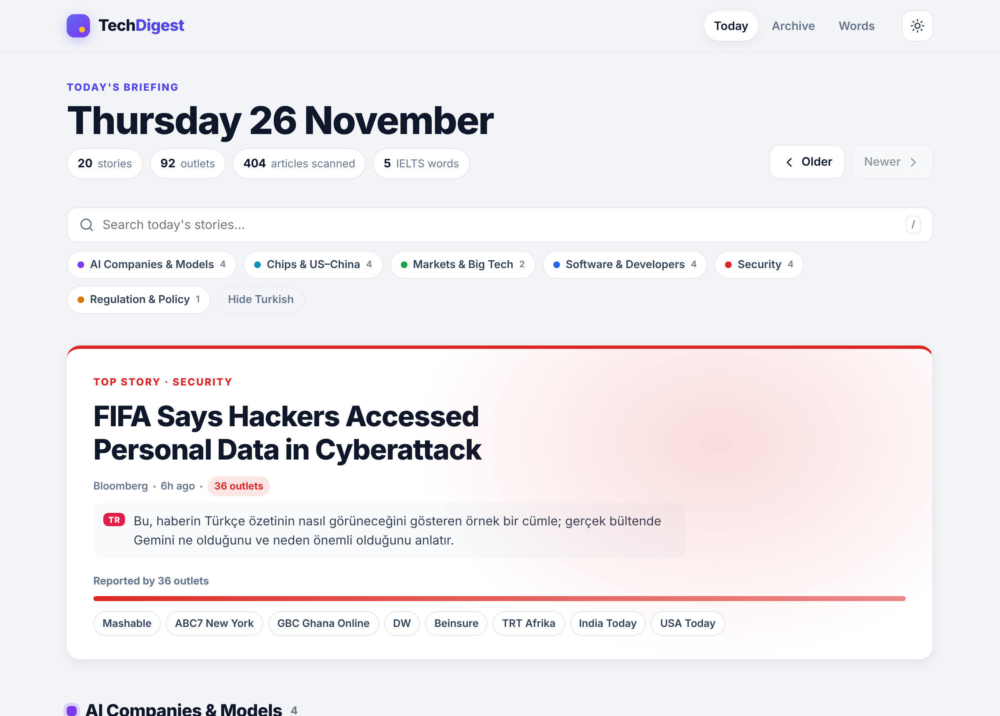
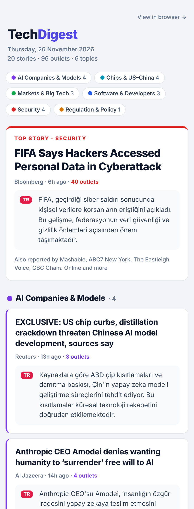
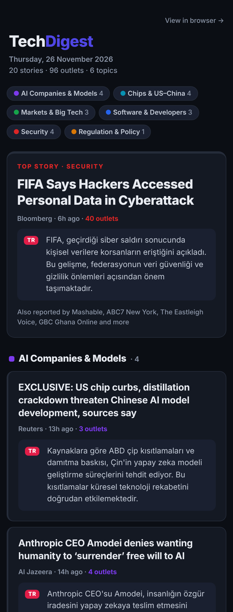
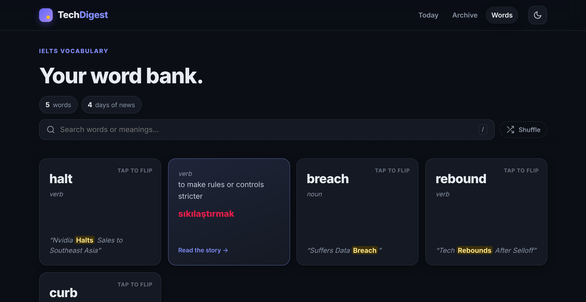
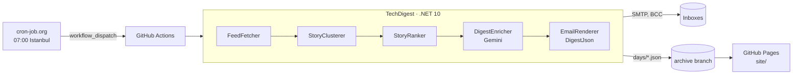

<div align="center">

# 🗞 TechDigest

**A daily tech briefing that reads 400+ articles so you don't have to.**

Every morning at 07:00 (Istanbul) it collects AI, chips, markets, software and security news from 14 feeds,
groups articles about the same event, ranks them by **how many outlets covered them**, adds a Turkish summary
to each story and picks five IELTS words from the day's English — then emails it and publishes it to a web archive.

[](https://github.com/yasinkocakdev/TechDigest/actions/workflows/ci.yml)
[](https://github.com/yasinkocakdev/TechDigest/actions/workflows/daily-digest.yml)


**[Live archive →](https://yasinkocakdev.github.io/TechDigest/)**



</div>

## What you get

| Email (Gmail, iCloud — light & dark) | Web archive |
|---|---|
|   | <br><br>• Search, topic filters, prev/next day<br>• "Hide Turkish" to practise reading in English<br>• Flip-card IELTS word bank of the last 30 days<br>• Light/dark theme, smooth transitions, works on phones |

## Built while learning

I'm building TechDigest while learning C# and preparing for IELTS — pair-programming with an AI assistant and making
sure I can explain every decision myself. The Turkish guide **[docs/NASIL-CALISIR.md](docs/NASIL-CALISIR.md)** walks
through the whole system (clustering, the scoring formula, Gemini fallbacks, security choices) and keeps a
**learning log** of the real problems I hit — like the "07:00" email that arrived at 15:00.

## How it decides what matters

Most "news digests" sort by keywords — so a keyword-stuffed post from a content farm beats a story that Reuters,
Bloomberg and twenty others are running. TechDigest scores **events**, not articles:

```
score = topic relevance (0–9)
      + 4 × log2(outlets covering it)      1 → 0 · 2 → 4 · 4 → 8 · 16 → 16
      + publisher quality                   Reuters/Bloomberg/FT +4 · The Verge/CNBC +2 · content farms −3
      + freshness                           last 6 h +2 · last 12 h +1
```

1. **Cluster** — headlines about the same event are grouped in two passes: word overlap, then a rarity-weighted
   (IDF) pass that catches rewordings (*"FIFA says hackers accessed data"* ≈ *"FIFA confirms cyberattack"*).
2. **Filter** — blocked publishers (stock-tip sites) and clickbait patterns ("…is it time to buy?") never make it in.
3. **Enrich** — one Gemini request returns Turkish summaries, semantic duplicates the rules missed, and five
   B2–C1 vocabulary words with the sentence they appeared in. If Gemini is down, the digest still goes out.
4. **Compose** — the highest-scoring event becomes the top story; each topic gets its best four.

## Architecture



| Path | What it does |
|---|---|
| `src/TechDigest/Pipeline/DigestPipeline.cs` | Runs the steps in order; everything else is injected, so it is tested end-to-end offline |
| `Services/Fetching/FeedFetcher.cs` | Parallel RSS/Atom fetch; 5 MB / 200 items per feed, no XML resolver, http(s)-only links |
| `Services/Ranking/` | `StoryClusterer`, `TopicMatcher`, `PublisherDirectory`, `StoryRanker`, `ContentFilter` |
| `Services/Enrichment/GeminiClient.cs` | Picks the newest available model, retries overloads, falls back across models, per-model timeout + total budget |
| `Services/Enrichment/DigestEnricher.cs` | One structured-output request; validates and sanitises everything the model returns |
| `Services/Rendering/` | Email (table layout, inline styles, dark mode), JSON for the site, shared design tokens |
| `config/*.json` | Feeds, topics (strong/weak keywords, colours), publisher tiers — tune without touching code |
| `site/` | Framework-free web archive: `index.html`, `styles.css`, `app.js` |

## Run it locally

Requires the [.NET 10 SDK](https://dotnet.microsoft.com/download).

```bash
dotnet test
dotnet run --project src/TechDigest -- --dry-run --verbose   # writes out/email.html, out/digest.json; sends nothing
```

Set `GEMINI_API_KEY` to include Turkish summaries and vocabulary. To preview the website, put an archive in
`site/data/` (`index.json` + `days/*.json`, e.g. with `ARCHIVE_DIR=site/data` and a real run) and serve the folder:
`python3 -m http.server -d site`.

## Setup

1. **Gmail app password** — enable 2-Step Verification on the sending account, then create an app password at
   <https://myaccount.google.com/apppasswords>.
2. **Gemini API key** (free, optional) — <https://aistudio.google.com/apikey>.
3. **Repository secrets** — *Settings → Secrets and variables → Actions*:

   | Secret | Value |
   |---|---|
   | `GMAIL_ADDRESS` | the Gmail address that sends the digest |
   | `GMAIL_APP_PASSWORD` | the 16-character app password |
   | `TO_ADDRESS` | recipients, comma-separated (sent as BCC) |
   | `GEMINI_API_KEY` | Gemini key (optional) |

4. **GitHub Pages** — *Settings → Pages → Source: GitHub Actions*.
5. **Daily trigger** — GitHub's own scheduler delayed runs by 8–10 hours, so the digest is triggered from
   [cron-job.org](https://cron-job.org):
   - URL `https://api.github.com/repos/yasinkocakdev/TechDigest/actions/workflows/daily-digest.yml/dispatches`,
     method `POST`, body `{"ref":"main"}`, every day 07:00 `Europe/Istanbul`
   - Headers `Authorization: Bearer <fine-grained token: this repo only, Actions read & write>`,
     `Accept: application/vnd.github+json`, `X-GitHub-Api-Version: 2022-11-28`
   - GitHub's scheduler (08:00) stays as a backup and skips itself if today's digest was already sent.
6. **Test** — *Actions → Daily TechDigest → Run workflow* (tick *Dry run* to build without sending or publishing;
   the rendered email is attached to the run as an artifact).

## Security & maintenance

- Secrets live only in GitHub Actions secrets; the Gemini key is sent in a header, never in a URL.
- All third-party actions are pinned to commit SHAs; Dependabot proposes NuGet and Actions updates weekly.
- `packages.lock.json` + locked restore in CI; known-vulnerable packages fail the build (NuGet audit).
- Everything from feeds and the model is sanitised and HTML-encoded; the site writes data only via
  `textContent` under a strict Content-Security-Policy.
- Token for cron-job.org expires yearly — renew it and update the job's `Authorization` header.

## License

[MIT](LICENSE)
